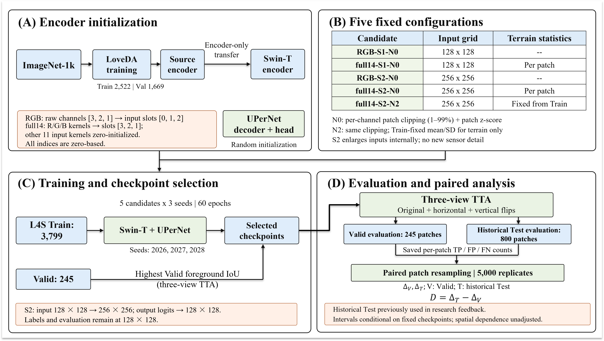

# 20261106 受控研究入口：LoveDA 源编码器 → Landslide4Sense

本目录是 2026-11-06 冻结的五配置研究的**发布入口**，与仓库历史的 0.4793 / 0.4426 / 0.4231 等结果**互不替代**：
旧结果是各自协议下的历史产物，本文档只描述本轮的五个受控配置。

## 1. 研究对象

Swin-T + UPerNet，把 LoveDA 源域 RGB 编码器迁移到 Landslide4Sense 滑坡二分类。

| 配置 | 输入 | 尺度 | 归一化 |
|---|---|---|---|
| RGB-S1-N0 | 物理 RGB（原始通道 [3,2,1]） | 原尺寸 128 | N0 |
| full14-S1-N0 | 全部 14 通道（原顺序 0–13） | 原尺寸 128 | N0 |
| RGB-S2-N0 | 物理 RGB | 模型内部 128→256→128 | N0 |
| full14-S2-N0 | 全部 14 通道 | 模型内部 128→256→128 | N0 |
| full14-S2-N2 | 全部 14 通道 | 模型内部 128→256→128 | N2（地形通道改用固定 Train 统计） |

- **没有新增网络模块。** S2 是尺度包装器：输入在模型内部上采样到 256 推理、再把 256 的 logits 折回 128，**不是新的观测分辨率**。
- **N2 只改地形两个通道**（坡度、DEM）的归一化统计，光谱 12 通道处理与 N0 完全相同。
- 兼容源码中存在的 STCA、均值初始化、额外损失等分支**在本轮五配置中均未启用**，不属于正式配置。

### 实验流程

Within each split, the same resampled patch indices are used across candidates and seeds. Valid and historical Test are resampled separately.

## 2. 训练与评价口径

- 数据划分：Train 3799 / Valid 245 / 历史 Test 800（patch 128×128×14）。
- 60 轮训练；**按 Valid 前景 IoU 选 best**；评价使用三视角 TTA（原图 + 水平翻转 + 垂直翻转，翻转回并平均 logits）。
- 只迁移 encoder；目标域 decoder 随机初始化。full14 输入中，源 RGB 核对到位置 3/2/1，其余 11 个输入核零初始化。

## 3. 主表（来自已保存 CSV/JSON 复算，四位小数）

| 配置 | Valid 均值 | Valid 样本 SD | 历史 Test 均值 | Test 样本 SD |
|---|---:|---:|---:|---:|
| RGB-S1-N0 | 0.4903 | 0.0070 | 0.4731 | 0.0141 |
| full14-S1-N0 | 0.5103 | 0.0052 | 0.4651 | 0.0040 |
| RGB-S2-N0 | 0.5106 | 0.0041 | 0.4994 | 0.0105 |
| full14-S2-N0 | 0.5507 | 0.0353 | 0.4710 | 0.0030 |
| full14-S2-N2 | 0.5294 | 0.0110 | 0.4864 | 0.0147 |

- 均值为三个 seed（2026/2027/2028）的算术平均；SD 是**三个 seed 的样本标准差**（n=3），不是置信区间。
- 逐 seed、逐样本记录见 `results/inputs/`；对照区间见 `results/bootstrap_summary.csv`。

## 4. 结论边界（必须与数字一起读）

1. **Valid 选模、历史 Test 参与过研究反馈**：本轮冻结不能把 Test 恢复成"全新独立确认"。
2. 配对 patch bootstrap 的区间**条件于固定检查点**，不含训练随机性、选模不确定性；未校正空间相关与多重比较。
3. C1（full14-S2 − RGB-S2）的 Test 区间跨零；D（Test 效应减 Valid 效应，D = ΔTest − ΔValid）区间不跨零，**不等于**"Test 下降本身已被确证"。
4. LoveDA 相对 ImageNet 的额外收益在本轮材料中**没有得到受控确证**。
5. 完整源训练命令仍有记录缺口，因此本仓库**不声称全链条无缺口可复现**。

## 5. 本目录包含什么 / 不包含什么

| 包含 | 说明 |
|---|---|
| `code_versions/` | 四个源码版本（RGB-S1、full14-S1、S2-N0、N2）的必要模块与既有单元测试，逐字节副本，附来源 SHA |
| `configs/` | 15 个运行的配置脱敏副本（5 配置 × 3 seed）与原件哈希 |
| `commands/` | 训练与评价命令模板（数据/权重/输出全部显式参数） |
| `environment/` | 训练环境快照（**不是可保证重建的 lockfile**） |
| `results/` | 30 组逐样本表、指标、协议，以及 bootstrap 汇总与逐 seed 效应 |
| `analysis/` | 已执行分析的源码（本次**未重跑** bootstrap） |
| `figures/` | G1/G2/G3 图件、主表/效应表 CSV 与重画脚本 |
| `provenance/` | 原始 manifest（不改动）、发布副本与原件映射（见下） |
| `weights_index.csv` | 15 个 best 与源权重的身份（SHA/大小）；**权重文件本身本次未上传** |

来源映射分两表，互补使用：

- `provenance/release_source_map.csv`：代码、配置、命令、环境、权重索引（111 条）；
- `provenance/release_source_map_results.csv`：统计、分析、图件与原始清单（129 条）。

两表都记录 `release_path / source_path / source_sha256 / derived / note`。`derived=true` 表示做了脱敏（只替换路径字符串），原件 SHA 仍保留在该行；**所有数值、超参、seed 与历史字段均未改动**。

| 不包含 | 原因 |
|---|---|
| 原始数据、H5、影像、GT | 第三方许可，需从官方渠道获取 |
| 模型权重 | 体积与许可；仅提供身份索引，按需申请 |
| 论文稿件、图件之外的原始预测数组 | 不在本次发布范围 |

## 6. 复现路径

1. 取数据：Landslide4Sense 官方仓库 <https://github.com/iarai/Landslide4Sense-2022>，按 `configs/` 中的目录约定放置。
2. 取权重：按 `weights_index.csv` 的 SHA 向作者索取；**仓库不含权重**。
3. 训练：见 `commands/train.md`；选模只用 Valid。
4. 评价：见 `commands/evaluate.md`；三视角 TTA 与严格二值指标口径见 `results/README.md`。
5. 统计复核（只读）：`python -I -X utf8 test_analysis.py` 一类的入口只做**已保存数值的复核**，不重跑 bootstrap。

## 7. 许可与历史身份

- 本目录不新增任何许可证；Landslide4Sense、LoveDA、Swin、UPerNet 沿用各自原始许可。
- 仓库历史结果（0.4793 / 0.4426 / 0.4231 等）保留在 `archive/` 与原有协议身份，不重新挂到本轮方案上。
- 旧 Sen12 材料继续保留其探索性身份，不作为本文的独立外部验证。

## 8. 历史材料

旧实现、旧协议、旧图件与旧流程图统一归档在 `archive/`，说明见 `archive/README.md`。它们不参与本轮受控结论；相关命令需在 `archive/` 目录下执行。
